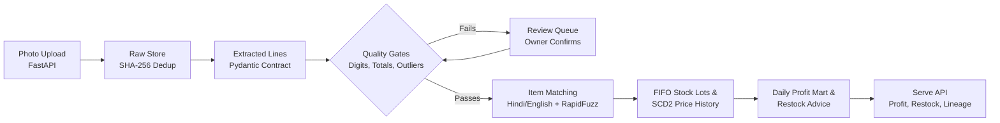

# Gullak (गुल्लक)

Shopkeepers keep handwritten sales registers and paper wholesale bills, so they only estimate their daily profit instead of knowing it. **Gullak** turns register and wholesale bill photos into trusted daily profit, best sellers, and actionable restock advice in Hindi.

## Architecture



## Quickstart (One Command)

```powershell
# Setup & install
python -m venv .venv
.venv\Scripts\activate
pip install -e ".[dev]"

# Run the 30-day synthetic pipeline & handwriting kit benchmark
python -m gullak.pipeline.runner --days 30
```

Other useful commands:

```powershell
# Run the full test suite (18 tests)
pytest -v

# Start the FastAPI service
uvicorn gullak.api.app:app --reload

# Generate 365 days of synthetic data & 30-page handwriting kit
python -m gullak.synth generate
python -m gullak.synth kit
```

## Data

No real shop data is used. Everything is synthetic, generated by `gullak.synth`:

- **Reference catalog (`data/reference/items.csv`)**: 60 common kirana items with Hindi/English names, units, wholesale packs, approximate cost/selling prices, shelf life, and festival multipliers.
- **Festival calendar (`data/reference/festivals.csv`)**: Festival windows for Nov 2025 – Nov 2026.
- **Day-by-day simulator (`gullak.synth.generator`)**: Simulates customer bills, wholesaler purchases with reorder rules, FIFO stock with expiry, cost drift with delayed price updates (creating below-cost sales), expenses, and wastage, outputting `daily_pnl_truth.csv`.
- **Handwriting test set (`data/handwriting_kit/`)**: 30 register pages (`kit.html` + `truth.json`, 450 lines total), with ~20% of pages using Devanagari digits (`०१२३`) to test digit normalization.

## Benchmark & Verification Results

Verified with `pytest -v` (18/18 passing) and `python -m gullak.pipeline.runner --days 30`:

- **Handwriting kit matching benchmark (`truth.json`, 30 pages / 450 lines)**:
  - Auto-matched rate: **100.0%**
  - Exact item accuracy: **100.0%**
- **30-day synthetic pipeline replay**:
  - `days_processed`: **30**
  - `total_sales` vs `truth_sales`: **₹343,000.00** vs **₹343,000.00**
  - FIFO gross profit: **₹44,583.99**

## Pipeline Modules & Rules

- **Validation Gates (`gullak.pipeline.validate`)**:
  - Converts Devanagari digits (`०१२३४५६७८९`) to ASCII before any check.
  - Requires page date, positive quantities and amounts, and line sums matching the written total within `₹1`.
  - Flags unit prices deviating by `> 50%` from recent item averages or low-confidence lines (`< 0.70`) to the review queue.
- **Item Matching (`gullak.pipeline.matching`)**:
  - Resolves Hindi/English spellings via exact match, shop alias table, and `rapidfuzz` (`WRatio`, threshold `75.0`), converting units (`ग्राम` → `kg`, `मिली` → `l`).
- **FIFO Costing & SCD2 Pricing (`gullak.pipeline.costing`)**:
  - Allocates sales chronologically across oldest `StockLot` records first; sales spanning multiple lots are costed partly at each lot's cost.
  - Sales without sufficient stock lots are marked `cost_missing` rather than guessed.
  - Selling-price updates maintain `valid_from` / `valid_to` SCD Type 2 history.
- **Restock & Margin Advice (`gullak.advice`)**:
  - **Restock**: Stock left won't cover `days_until_next_trip + buffer_days` (default buffer: `2` days).
  - **Don't restock**: Stock covers `≥ 30` days (overstock), no sales in `14` days, or stock expires within `7` days.
  - **Watch margin**: Selling price is below cost or margin is `≤ 3%`.
- **FastAPI Service (`gullak.api.app`)**:
  - Multi-tenant shop profiles (`/shops`), SHA-256 photo deduplication (`/ingest/photo`), extracted page processing (`/ingest/extracted`), wholesale bill approval (`/bills/{bill_id}/approve`), review queue resolution (`/shops/{shop_id}/review-queue/{review_id}/resolve`), daily summary (`/shops/{shop_id}/daily-summary`), and per-line lineage (`/shops/{shop_id}/lineage/{sale_line_id}`).

## Design Decisions & Trade-offs

- **Validation gates over trusting OCR**: Bad or mismatched pages go to a review queue rather than silently corrupting daily profit.
- **FIFO lots over weighted average cost**: Preserves exact cost transitions when seasonal wholesale prices change, exposing margin shifts as old stock runs out.
- **Never guess missing cost**: Items sold before a wholesale bill is approved are flagged as `cost_missing` instead of inventing a cost.
- **Content-hash deduplication**: Photos are keyed by SHA-256 hash so duplicate uploads are idempotent.
- **In-memory/local store for core pipeline**: Keeps the core pipeline fast and runnable with zero external services; Postgres (`docker-compose.yml`), MinIO, dbt, and Prefect can be layered on next.
