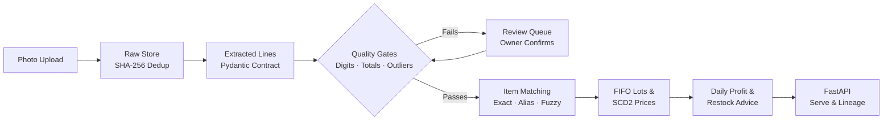

# Gullak


Small shopkeepers record sales in handwritten registers and keep paper wholesale bills, leaving them to estimate their daily profit instead of knowing it. **Gullak** turns photos of those registers and bills into accurate daily profit, top-selling items, and clear restock guidance in the owner's chosen language — built for retail, wholesale, pharmacy, hardware, grocery, and general stores.

---

## The Problem & How Gullak Solves It

| Today's Challenge | Gullak's Approach |
| --- | --- |
| Typing every sale into a billing app slows down busy counters | Photograph the handwritten register page at the end of the day |
| Seasonal wholesale price changes make profit hard to estimate | FIFO stock lots track exact purchase costs batch by batch |
| OCR mistakes silently corrupt totals in naive tools | Quality gates route doubtful lines to a quick owner review queue |
| Most software assumes one language or one store format | Shopkeepers choose their own language and maintain custom item catalogs |

---

## Architecture



---

## Quickstart

### Run the Pipeline in One Command

```powershell
python -m venv .venv
.venv\Scripts\activate
pip install -e ".[dev]"
python -m gullak.pipeline.runner --days 30
```

### Run Tests & Start the API

```powershell
pytest -v                               # Run full test suite (20 tests)
uvicorn gullak.api.app:app --reload     # Start API (docs at http://127.0.0.1:8000/docs)
```

### Generate Synthetic Data & Handwriting Kit

```powershell
python -m gullak.synth generate         # Generate 365 days -> data/synthetic/
python -m gullak.synth kit              # Generate 30 register pages -> data/handwriting_kit/
```

---

## Multi-Language & Multi-Shop Support

| Capability | Details |
| --- | --- |
| **Supported Languages** | English (`en`), Hindi (`hi`), Marathi (`mr`), Gujarati (`gu`), Tamil (`ta`), Telugu (`te`) |
| **Language Selection** | Choose on shop creation (`POST /shops`), switch anytime (`PATCH /shops/{shop_id}/language`), or override per query (`?lang=`) |
| **All Shop Types** | Supports `retail`, `wholesale`, `pharmacy`, `hardware`, `electronics`, `kirana`, or any custom `shop_type` |
| **Custom Catalogs** | Start clean (`seed_catalog=false`) and register custom items (`POST /shops/{shop_id}/items`) and local aliases (`POST /shops/{shop_id}/aliases`) |

---

## Core Rules

### Costing & Lineage (`gullak.pipeline.costing`)

- **FIFO Lot Allocation:** Oldest stock lots are consumed first; sales spanning multiple wholesale bills are costed partly at each bill's unit cost.
- **No Guessed Costs:** Items sold without an available stock lot are flagged as `cost_missing` rather than estimated.
- **SCD Type 2 Pricing:** Selling-price updates maintain `valid_from` and `valid_to` history per shop and item.
- **Full Lineage:** Every profit figure traces back to its `source_image_hash`, `source_line_no`, and `lot_allocations`.

### Restock & Margin Advice (`gullak.advice`)

| Advice | Rule | Default |
| --- | --- | --- |
| **Restock** | Stock left won't last until the next wholesale trip + buffer | `buffer_days = 2` |
| **Don't restock** | Stock left covers too many days (overstock) | `overstock_days = 30` |
| **Don't restock** | No sales recorded in recent days | `no_sale_days = 14` |
| **Don't restock** | Stock is close to expiry | `expiry_warning_days = 7` |
| **Watch margin** | Selling price is below cost or margin is too thin | `margin_warning_pct = 3%` |

---

## API Reference

| Method | Endpoint | Description |
| --- | --- | --- |
| `GET` | `/languages` | List available user languages |
| `POST` | `/shops` | Create a shop profile (`shop_type`, `language`, `seed_catalog`) |
| `PATCH` | `/shops/{shop_id}/language` | Update a shop's preferred language |
| `POST` | `/shops/{shop_id}/items` | Add custom catalog items for any shop type |
| `POST` | `/shops/{shop_id}/aliases` | Add local or regional item aliases |
| `POST` | `/ingest/photo` | Upload photo with SHA-256 content-hash deduplication |
| `POST` | `/ingest/extracted` | Validate, match, and process extracted register/bill lines |
| `POST` | `/bills/{bill_id}/approve` | Approve wholesale bill lines, create FIFO lots, and update prices |
| `GET` | `/shops/{shop_id}/review-queue` | List pages and lines awaiting owner confirmation |
| `POST` | `/shops/{shop_id}/review-queue/{review_id}/resolve` | Submit corrected lines and reprocess |
| `GET` | `/shops/{shop_id}/daily-summary` | Daily profit, best sellers, and localized restock advice |
| `GET` | `/shops/{shop_id}/lineage/{sale_line_id}` | Trace a sale's profit to its source photo, line, and FIFO lots |

---

## Verification & Benchmarks

Verified with `pytest -v` (**20/20 passing**) and `python -m gullak.pipeline.runner --days 30`:

| Check | Result |
| --- | --- |
| **Unit & End-to-End Tests** | `20 passed` across advice, validation, matching, FIFO, API, and synthetic simulator |
| **Handwriting Kit (`truth.json`)** | `30 pages` / `450 lines` — **100.0%** auto-matched, **100.0%** exact item accuracy |
| **30-Day Synthetic Replay** | `₹343,000.00` computed sales vs `₹343,000.00` truth sales (`₹44,583.99` FIFO gross profit) |

---

## Design Decisions

- **Validation over blind OCR:** Pages failing date, positivity, total (`±₹1`), or price-outlier (`>50%`) checks go to a review queue rather than corrupting profit.
- **FIFO lots over weighted averages:** Captures exact margin shifts as old inventory sells out and new wholesale prices take effect.
- **Idempotent ingestion:** Photos are keyed by SHA-256 hash so duplicate uploads are safely ignored.
- **Lightweight local execution:** Runs in-memory/on-disk with zero external services; Postgres (`docker-compose.yml`), MinIO, dbt, and Prefect can be layered on as needed.

---

## Project Structure

```text
├── data/
│   ├── reference/              # Sample item catalog & festival calendar
│   └── handwriting_kit/        # 30-page handwritten benchmark (kit.html + truth.json)
├── src/gullak/
│   ├── advice.py               # Restock, overstock, expiry, and margin advice engine
│   ├── i18n.py                 # Multi-language templates (en, hi, mr, gu, ta, te)
│   ├── api/app.py              # FastAPI service
│   ├── pipeline/
│   │   ├── contracts.py        # Pydantic data contracts
│   │   ├── validate.py         # Digit normalization & quality gates
│   │   ├── matching.py         # Exact, alias, and RapidFuzz matching + unit conversion
│   │   ├── costing.py          # FIFO lot allocation, SCD2 pricing, daily profit mart
│   │   ├── store.py            # Multi-tenant store & lineage tracking
│   │   └── runner.py           # Synthetic replay & handwriting kit benchmark CLI
│   └── synth/                  # Synthetic shop simulator & handwriting kit generator
└── tests/                      # Unit, API, and end-to-end test suite (20 tests)
```
