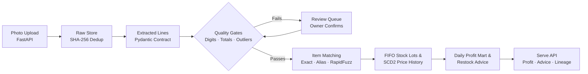

# Gullak (गुल्लक)


**Small shopkeepers record sales in handwritten registers and keep paper wholesale bills, leaving them to estimate their daily profit instead of knowing it.**  
**Gullak** turns photos of those registers and bills into accurate daily profit, top-selling items, and clear restock guidance in the owner's chosen language — built for retail, wholesale, pharmacy, hardware, grocery, and general stores alike.

---

## Why Gullak?

| Today's Reality | With Gullak |
| --- | --- |
| Billing apps require typing every sale at a busy counter | Snap a photo of the handwritten register at the end of the day |
| Wholesale prices change by season, making profit a rough guess | FIFO stock lots track exact purchase costs per batch |
| OCR errors silently corrupt totals in naive tools | Strict quality gates route doubtful lines to a quick review queue |
| Most tools assume one language or one store format | Shopkeepers pick their native language and manage custom item catalogs |

---

## Architecture



---

## Quickstart

### 1. Setup & Run in One Command

```powershell
python -m venv .venv
.venv\Scripts\activate
pip install -e ".[dev]"
python -m gullak.pipeline.runner --days 30
```

### 2. Run Tests & Start the API Server

```powershell
# Run the full test suite (20 tests)
pytest -v

# Start FastAPI server (interactive docs at http://127.0.0.1:8000/docs)
uvicorn gullak.api.app:app --reload
```

### 3. Generate Synthetic Data & Handwriting Kit

```powershell
python -m gullak.synth generate   # 365 days -> data/synthetic/
python -m gullak.synth kit        # 30 register pages -> data/handwriting_kit/
```

---

## Multi-Language & Multi-Shop Support

- **Languages offered (`GET /languages`)**: English (`en`), हिन्दी (`hi`), मराठी (`mr`), ગુજરાતી (`gu`), தமிழ் (`ta`), and తెలుగు (`te`). Shopkeepers can select a language at onboarding (`POST /shops`), switch anytime (`PATCH /shops/{shop_id}/language`), or override per request (`?lang=mr`).
- **Built for any shopkeeper**: Supports `retail`, `wholesale`, `pharmacy`, `hardware`, `electronics`, `kirana`, or any custom `shop_type`. Shops can seed from reference items or start empty (`seed_catalog=false`) and add their own products (`POST /shops/{shop_id}/items`) and local-language aliases (`POST /shops/{shop_id}/aliases`).

---

## Business & Accounting Rules

### Costing & Profit (`gullak.pipeline.costing`)
- **FIFO Lot Allocation**: Oldest stock lots are consumed first; a sale spanning two wholesale bills is costed partly at each bill's unit cost.
- **No Guessed Costs**: Items sold without an available stock lot are flagged as `cost_missing` rather than estimated.
- **SCD Type 2 Price History**: Selling-price updates track `valid_from` and `valid_to` dates per shop and item.
- **End-to-End Lineage**: Every profit number traces back to its `source_image_hash`, `source_line_no`, and `lot_allocations`.

### Restock & Margin Advice (`gullak.advice`)

| Advice | Rule | Default Parameter |
| --- | --- | --- |
| **Restock** | Stock left won't last until next wholesale trip + buffer | `buffer_days = 2` |
| **Don't restock** | Stock left covers too many days (overstock) | `overstock_days = 30` |
| **Don't restock** | No sale recorded in recent days | `no_sale_days = 14` |
| **Don't restock** | Stock is close to expiry | `expiry_warning_days = 7` |
| **Watch margin** | Selling price is below cost or margin is too thin | `margin_warning_pct = 3%` |

---

## API Endpoints

| Method | Endpoint | Purpose |
| --- | --- | --- |
| `GET` | `/languages` | List supported user languages |
| `POST` | `/shops` | Create a shop profile (`shop_type`, `language`, `seed_catalog`) |
| `PATCH` | `/shops/{shop_id}/language` | Switch a shop's preferred language |
| `POST` | `/shops/{shop_id}/items` | Add custom catalog items for any shop type |
| `POST` | `/shops/{shop_id}/aliases` | Add local/regional spelling aliases |
| `POST` | `/ingest/photo` | Upload photo with SHA-256 content-hash deduplication |
| `POST` | `/ingest/extracted` | Validate, match, and process extracted lines |
| `POST` | `/bills/{bill_id}/approve` | Approve wholesale bill lines, create FIFO lots & update prices |
| `GET` | `/shops/{shop_id}/review-queue` | View flagged pages/lines needing confirmation |
| `POST` | `/shops/{shop_id}/review-queue/{review_id}/resolve` | Submit corrected lines and reprocess |
| `GET` | `/shops/{shop_id}/daily-summary` | Daily profit, best sellers, and localized restock advice |
| `GET` | `/shops/{shop_id}/lineage/{sale_line_id}` | Trace sale profit to source photo, line, and FIFO lots |

---

## Verification & Benchmark Results

Verified with `pytest -v` (**20/20 passing**) and `python -m gullak.pipeline.runner --days 30`:

- **Handwriting test set (`data/handwriting_kit/truth.json`, 30 pages / 450 lines)**:
  - Auto-matched rate: **100.0%**
  - Exact item accuracy: **100.0%**
- **30-day synthetic pipeline replay**:
  - `days_processed`: **30**
  - `total_sales` vs `truth_sales`: **₹343,000.00** vs **₹343,000.00**
  - FIFO gross profit: **₹44,583.99**

---

## Design Decisions & Trade-offs

- **Validation gates over trusting OCR**: Pages failing date, positivity, total (`±₹1`), or price-outlier (`>50%`) checks go to a review queue instead of corrupting profit.
- **FIFO lots over weighted average cost**: Preserves exact cost transitions when wholesale prices shift across seasons.
- **Content-hash deduplication**: Photos are keyed by SHA-256 hash so duplicate uploads are safe and idempotent.
- **Zero-dependency core store**: Runs locally in-memory/on-disk with zero external setup; Postgres (`docker-compose.yml`), MinIO, dbt, and Prefect can be layered on as needed.

---

## Project Structure

```text
├── data/
│   ├── reference/          # Sample item catalog & festival calendar
│   └── handwriting_kit/    # 30-page handwritten benchmark (kit.html + truth.json)
├── src/gullak/
│   ├── advice.py           # Restock, overstock, expiry, and margin advice engine
│   ├── i18n.py             # Multi-language templates (en, hi, mr, gu, ta, te)
│   ├── api/app.py          # FastAPI service
│   ├── pipeline/
│   │   ├── contracts.py    # Pydantic data contracts
│   │   ├── validate.py     # Digit normalization & quality gates
│   │   ├── matching.py     # Exact, alias, and RapidFuzz item matching + unit conversion
│   │   ├── costing.py      # FIFO lot allocation, SCD2 pricing, daily profit mart
│   │   ├── store.py        # Multi-tenant store & lineage tracking
│   │   └── runner.py       # Synthetic replay & handwriting kit benchmark CLI
│   └── synth/              # Synthetic shop simulator & handwriting kit generator
└── tests/                  # Unit, API, and end-to-end tests (20 tests)
```
